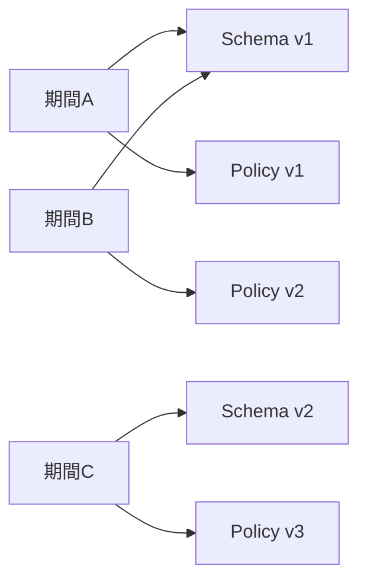

過去に出力したものは当時の仕様のまま出力し続けることが求められる機能があります。

こうした機能に仕様変更が入ったとき、過去分の出力に影響を出さずに変更を積み重ねていくための設計について考えています。

今回は請求書を例にします。

## 請求書の仕様変更の2つの要因

請求書の仕様変更には、主に2つの要因があります。

### 記載欄の変更

1つは請求書が持つ記載欄の変更です。

例えば、請求書に記載欄が増えたり減ったり順序が変わったりするような変更がこれにあたります。

### 記載内容の変更

もう1つは記載内容の変更です。

例えば、どの明細を記載するか、金額の算出方法、備考などの文言といった変更がこれにあたります。

## Schema・Policy・Format

この2つの要因を、それぞれ別のものとしてバージョン管理します。

| 名前 | 役割 | 管理する変更 |
|---|---|---|
| `Schema` | 請求書にどんな記載欄があるかを表す | 記載欄の増減・順序の変更 |
| `Policy` | 請求書の記載欄に何を入れるかを表す | 記載する明細、金額の算出方法、文言の変更 |
| `Format` | 期間ごとに `Schema` と `Policy` を組み合わせ、出力の仕様を決める | どの期間にどのバージョンを使うか |

### Schema

`Schema` は請求書にどんな記載欄があるかを表し、バージョンを持ちます。

PDFであれば記載欄の有無や明細表の列、CSVであれば列の定義がこれにあたります。

記載欄が増減したり順序が変わったりするときは、新しいバージョンの `Schema` を追加します。

### Policy

`Policy` は記載欄に何を入れるか、つまり記載内容を表し、バージョンを持ちます。

PDFであれば明細にどの項目を載せるかや備考の文言、CSVであればどの種類の行を出すかや各行の値がこれにあたります。

記載内容が変わるときは、新しいバージョンの `Policy` を追加します。

### Schema と Policy の線引き

- 記載欄そのものを足したり減らしたり、並べ替えたりする必要がある → `Schema`
- 今の記載欄のままで表現できる → `Policy`

例えば、インボイス対応の場合、登録番号の記載欄を追加するのは `Schema` の変更です。一方で、消費税計算の方法が変わるのは、記載欄はそのままに内容のみが変わるので `Policy` の変更です。

また、新しいサービスが追加されて請求の明細行が追加される場合は、記載欄はそのままに記載する行が増えるだけなので `Policy` の変更です。

### Format

`Format` は、期間ごとに `Schema` と `Policy` のどのバージョンを組み合わせるかを決めます。

この組み合わせが、その期間の請求書の出力の仕様になります。

| 期間 | Schema | Policy |
|---|---|---|
| 期間A | v1 | v1 |
| 期間B | v1 | v2 |
| 期間C | v2 | v3 |



記載内容だけが変わったときは、`Policy` のバージョンだけが切り替わります。

記載欄が増えたときは、その欄に記載する内容も必要になるため、`Schema` と `Policy` の両方のバージョンが切り替わります。それでも、記載欄の定義は `Schema` が、記載内容は `Policy` が持つという責務の分け方は変わりません。

過去分を出力するときは、その期間の `Format` が指す組み合わせを使うことで、当時の仕様のまま出力できます。

`Schema` と `Policy` は互いの中身を知らないため、どの組み合わせなら正しく出力できるかを保証するのは `Format` の責務です。

## サンプルコード

`Schema`・`Policy`・`Format` の関係を、簡略化した Ruby のコードで示します。

### Schema

`Schema` は記載欄の並びと、各記載欄でどのインターフェースを呼び出すかだけを知っています。呼び出した先でどのような値が作られるかは知りません。

```rb
class Schema
  class Field
    attr_reader :label

    def initialize(label:, &value)
      @label = label
      @value = value
      freeze
    end

    def value_for(content)
      @value.call(content)
    end
  end

  def initialize(fields:)
    @fields = fields.freeze
    freeze
  end

  def render(content)
    @fields.map { |field| [field.label, field.value_for(content)] }
  end

  V1 = new(fields: [
    Field.new(label: '請求番号', &:number),
    Field.new(label: '明細', &:lines),
    Field.new(label: '消費税', &:tax_amount),
    Field.new(label: '合計金額', &:total_amount),
    Field.new(label: '備考', &:note)
  ])

  # 支払期限の記載欄を追加
  V2 = new(fields: [
    Field.new(label: '請求番号', &:number),
    Field.new(label: '支払期限', &:due_on),
    Field.new(label: '明細', &:lines),
    Field.new(label: '消費税', &:tax_amount),
    Field.new(label: '合計金額', &:total_amount),
    Field.new(label: '備考', &:note)
  ])
end
```

### Policy

`Policy` は記載欄に入れる内容を決めます。どんな記載欄があるか、どう並ぶかは知りません。

金額の計算などの具体的なロジックは請求のモデルがメソッドとして持っています。`Policy` は、そのうちどのメソッドの結果を記載内容とするかを選ぶだけです。

```rb
class Billing
  # ...

  def lines_in_amount_order
    lines.sort_by { |line| -line.amount }
  end

  def tax_amount
    subtotal * 10 / 100
  end

  def total_amount
    subtotal + tax_amount
  end
end
```

```rb
module Policy
  class V1
    Content = Data.define(:number, :lines, :tax_amount, :total_amount, :note)

    def content_for(billing)
      Content.new(
        number: billing.number,
        lines: billing.lines,
        tax_amount: billing.tax_amount,
        total_amount: billing.total_amount,
        note: 'お振込手数料はご負担ください。'
      )
    end
  end

  # 明細を金額の大きい順に記載し、備考の文言を変更
  class V2
    Content = Data.define(:number, :lines, :tax_amount, :total_amount, :note)

    def content_for(billing)
      Content.new(
        number: billing.number,
        lines: billing.lines_in_amount_order,
        tax_amount: billing.tax_amount,
        total_amount: billing.total_amount,
        note: 'お振込手数料は貴社にてご負担をお願いいたします。'
      )
    end
  end

  # Schema::V2 で追加された支払期限の記載欄に入れる内容を追加
  class V3
    Content = Data.define(:number, :due_on, :lines, :tax_amount, :total_amount, :note)

    def content_for(billing)
      Content.new(
        number: billing.number,
        due_on: billing.due_on,
        lines: billing.lines_in_amount_order,
        tax_amount: billing.tax_amount,
        total_amount: billing.total_amount,
        note: 'お振込手数料は貴社にてご負担をお願いいたします。'
      )
    end
  end
end
```

`Policy` 同士の差分は、どのメソッドを呼ぶかと文言だけになります。

### Format

`Format` は期間ごとに `Schema` と `Policy` の組み合わせを決め、両者をつなぎます。

```rb
class Format
  def self.for(issued_on:)
    if issued_on < Date.new(2023, 4, 1)
      new(schema: Schema::V1, policy: Policy::V1.new)
    elsif issued_on < Date.new(2023, 10, 1)
      new(schema: Schema::V1, policy: Policy::V2.new)
    else
      new(schema: Schema::V2, policy: Policy::V3.new)
    end
  end

  def initialize(schema:, policy:)
    @schema = schema
    @policy = policy
    freeze
  end

  def render(billing)
    @schema.render(@policy.content_for(billing))
  end
end

Format.for(issued_on: billing.issued_on).render(billing)
```

日付による分岐は `Format.for` の1箇所に集約され、どの期間がどのバージョンを使っているかがここを見ればわかります。

`Schema::V2` は `due_on` を呼び出すため、`Policy::V1` や `Policy::V2` と組み合わせると出力時にエラーになります。このような誤った組み合わせを作らないことも、`Format` の責務です。

## テスト

正しい組み合わせを保証するのは `Format` なので、`Format` に対して、期間ごとに請求書が期待どおりに出力されるかをテストします。

```rb
RSpec.describe Format do
  describe '#render' do
    subject(:rendered) { Format.for(issued_on:).render(billing) }

    let(:billing) { create(:billing, issued_on:) }

    context '期間A' do
      let(:issued_on) { Date.new(2023, 3, 31) }

      it 'Schema v1 と Policy v1 で出力する' do
        expect(rendered).to eq([
          ['請求番号', billing.number],
          ['明細', billing.lines],
          ['消費税', billing.tax_amount],
          ['合計金額', billing.total_amount],
          ['備考', 'お振込手数料はご負担ください。']
        ])
      end
    end

    context '期間B' do
      let(:issued_on) { Date.new(2023, 4, 1) }

      it 'Schema v1 と Policy v2 で出力する' do
        expect(rendered).to eq([
          ['請求番号', billing.number],
          ['明細', billing.lines_in_amount_order],
          ['消費税', billing.tax_amount],
          ['合計金額', billing.total_amount],
          ['備考', 'お振込手数料は貴社にてご負担をお願いいたします。']
        ])
      end
    end

    context '期間C' do
      let(:issued_on) { Date.new(2023, 10, 1) }

      it 'Schema v2 と Policy v3 で出力する' do
        expect(rendered).to eq([
          ['請求番号', billing.number],
          ['支払期限', billing.due_on],
          ['明細', billing.lines_in_amount_order],
          ['消費税', billing.tax_amount],
          ['合計金額', billing.total_amount],
          ['備考', 'お振込手数料は貴社にてご負担をお願いいたします。']
        ])
      end
    end
  end
end
```

出力全体の構成を `eq` で比較するので、記載欄の増減・順序の入れ替わり・記載内容の変化のどれが起きてもテストが失敗します。

すべての組み合わせをテストしておけば、誤った組み合わせはテストで検出できます。

また、`Schema` と `Policy` 以外の共通のコード（請求のモデルのメソッドなど）を修正したときに、過去分の出力が変わっていないことも、このテストで確認できます。

## この設計で目指すもの

### 差分の把握

記載欄の変更と記載内容の変更が、それぞれ `Schema` と `Policy` のバージョンとして分かれているため、いつ何が変わったのかを把握しやすくなると考えています。

### 影響範囲の閉じ込め

仕様変更は新しいバージョンの `Schema` や `Policy` の追加と、`Format` の組み合わせの追加として表現されます。

既存のバージョンには手を入れないため、変更の影響は新しい期間の出力に閉じ込められます。

`Schema` と `Policy` 以外の共通のコードを修正することもありますが、それは出力内容に変更が生じないことが前提で、期間ごとの出力のテストで確認します。出力内容が変わる変更は、必ず新しいバージョンの `Schema` や `Policy` として表現します。

### メンテナンス性

記載欄と記載内容という性質の異なる変更を分けて扱うことで、どちらか一方の変更のたびにもう一方まで考慮する必要がなくなり、メンテナンスしやすいシステムを目指しています。

## この設計を考えるまでの経緯

この設計を考えるまでには、いくつかの段階を経ています。

### 第1段階: 日付による条件分岐

元々は、請求書の生成ロジックの中に特定の日付による条件分岐が実装されていました。

この状態では、仕様変更のためにコードを修正したとき、その修正が過去の請求書にどのように影響するかがわかりません。そのため、コード修正のコストが高くなっていました。

### 第2段階: 生成ロジック全体を期間ごとにバージョン分け

最初の改善として、生成ロジック全体を期間ごとにバージョン分けしました。

これにより、コードの変更の影響はバージョン内に閉じるようになりました。

しかし、バージョンが切り替わるたびにロジック全体が複製されるため、重複したコードが増えていきました。

また、バージョン間の差分に関係のないコードを修正したい場合でも、ロジック全体が複製されているため、どのコードがそれに該当するのかがわかりません。さらに、各バージョンで微妙にロジックが変更されているため、それを追うのも大変でした。

### 第3段階(検討中): 仕様変更の要因ごとにバージョン分け

そこで、バージョン分けする範囲を限定することを考えています。

生成ロジック全体ではなく、記載欄と記載内容という仕様変更の要因ごとに `Schema` と `Policy` としてバージョン分けし、`Format` で組み合わせるのが、この記事で紹介した設計です。

バージョンを持つのは仕様変更によって変わる部分だけになるため、ロジック全体を複製する必要がなくなり、重複したコードも減らせるはずです。

また、バージョン間の差分は `Schema` と `Policy` の各バージョンに集約されるため、差分を追いやすくなるはずです。出力内容に変更が生じない修正であれば、共通のコードを1箇所修正するだけで済むことも期待しています。
